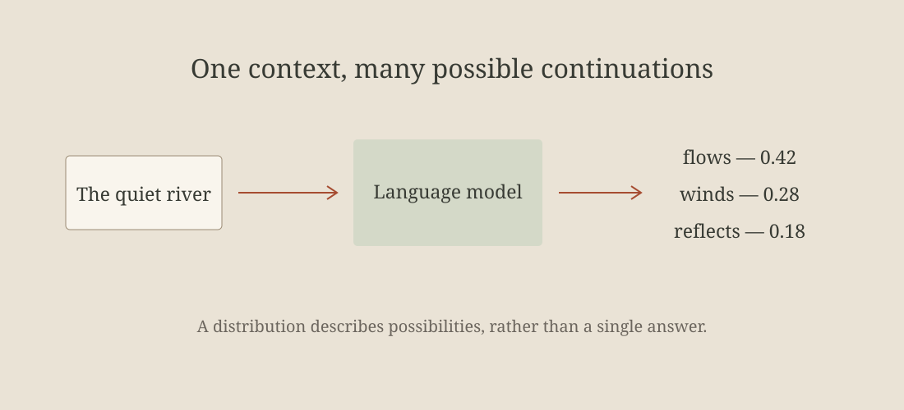

A language model begins with an ordinary question: given everything we have read so far, what could come next? The interesting part is not that a machine can choose a word. It is that many plausible continuations can coexist, and that their relative probabilities change with context.

This walkthrough starts with a small sequence rather than an enormous architecture diagram. We will look at the input, follow a prediction, and then ask what an experiment can tell us. Keeping the example small makes each choice easier to inspect.

## Start with the sequence

Take the phrase “the quiet river.” We might continue it with “flows,” “winds,” or “reflects.” None of those choices is the only possible answer. The model represents a distribution over its vocabulary, assigning a probability to each continuation.



The tokenizer first converts the text into a sequence of IDs. A token is not always a whole word: punctuation, fragments, and whitespace can matter too. This distinction becomes particularly visible when we move between languages.

> A useful first experiment keeps the input small enough that we can still explain what changed.

### Context changes the question

Add “after the storm” to the beginning. The vocabulary is unchanged, but the continuation distribution may shift. The model is answering a different conditional question, even though the last three words stay the same.

For a context $x_{1:t}$, the next-token distribution is written as:

$$
p(x_{t+1} \mid x_{1:t}) = \operatorname{softmax}(W h_t).
$$

The notation describes the boundary between an internal representation and an observable prediction. It does not tell us that the representation is correct, or that the most likely continuation is always useful.

## Inspect one prediction

The following code keeps the selection step explicit. A useful experiment log records the context length, the selected token's probability, and the sampling policy. Keeping those conditions beside the output makes later comparisons easier to interpret.

```python
distribution = model(context)
next_token = distribution.argmax()
print(vocabulary[next_token])
print("context_length", len(context), "selected_probability", distribution[next_token], "diagnostic_note", "inspect the full distribution before drawing a conclusion")
```

Greedy selection is one policy. Sampling is another. Changing the selection policy does not retrain the model, but it changes the sequence we observe. A comparison should say which policy was used, together with any random seed or temperature that affects the result.

When an output looks surprising, inspect the alternatives. A tiny probability difference between the first two candidates is a different situation from a distribution concentrated on one candidate. The final sentence alone cannot show that difference.

## Design a comparison

We need a question before we need a benchmark. For example: does a longer context help distinguish two meanings of the same word? A good comparison changes the relevant context while keeping unrelated choices fixed.

| Choice | Short context | Longer context | What the comparison reveals |
| :--- | :--- | :--- | :--- |
| Input | Three tokens | A complete sentence | Sensitivity to available context |
| Selection | Greedy | Greedy | A controlled prediction policy |
| Observation | Top candidates | Top candidates | More than the final selected token |
| Limitation | One local case | One local case | No claim about general capability |

Write down the prediction you expect before running the comparison. That prediction can be wrong; in fact, noticing a mismatch is often more useful than producing an attractive chart after the fact.

### Keep the observation separate

An observation is what happened in this run. An explanation is an account of why it happened. We should not merge them into one sentence and quietly turn a plausible story into evidence.

1. Record the exact input and selection policy.
2. Look at the candidate probabilities, not only the final token.
3. Change one part of the context and repeat.
4. Describe the uncertainty that remains.

The [Transformer paper](https://arxiv.org/abs/1706.03762) is a useful place to connect this local exercise with the broader architecture. Reading an architecture alongside an inspectable example can make the abstractions easier to question.

## Read the failure carefully

A model can produce a fluent continuation that misses the intended meaning. Fluency and task success are different observations. To investigate the failure, we need the original prompt, the intended task, and a criterion that does not change after seeing the answer.

Longer context can help, but it can also add irrelevant material. More parameters can change capability, but a single successful example cannot establish a scaling trend. A small experiment earns its value through a clear question and a clear limit.

Do not discard an inconvenient result simply because it does not fit the explanation. Keep it beside the successful case. The contrast may expose an ambiguity in the task or suggest the next controlled comparison.

## What to carry forward

The next-token view is a starting point, not a complete explanation of language-model behavior. It gives us something concrete to inspect: a sequence, a distribution, a selection policy, and a record of what changed.

The next step is to connect the local prediction to a complete task. Keep the same discipline: state the question, preserve the input, distinguish evidence from interpretation, and make the limits visible.[^scope]

[^scope]: This walkthrough describes an illustrative experiment. It makes no claim about a trained model or measured result.
